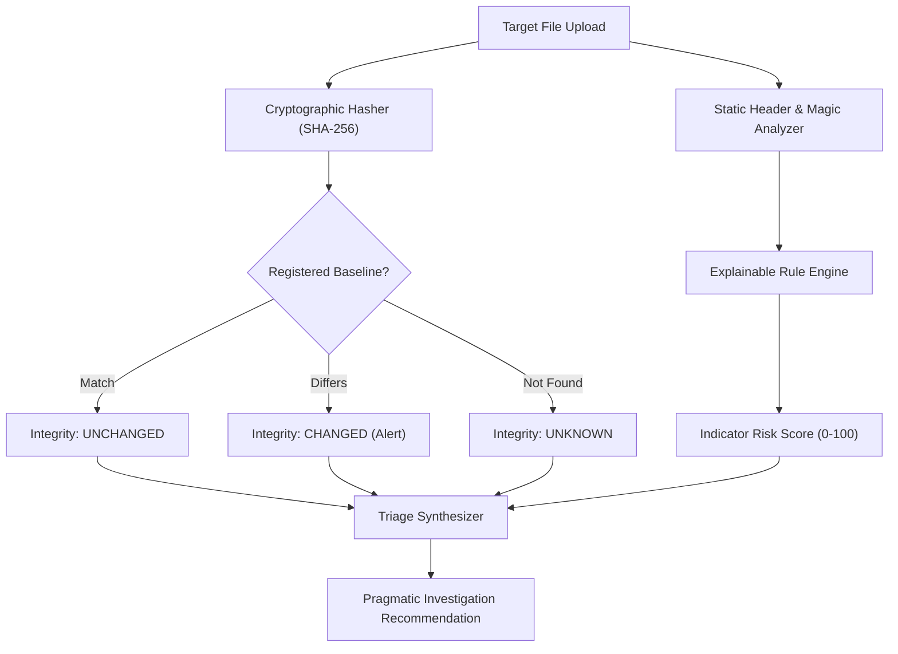

# TRACEGUARD AI

> **"Verify. Investigate. Trust."**

[](https://www.python.org/)
[](https://streamlit.io/)
[]()
[]()

---

## 1. Executive Summary

**TRACEGUARD AI** is an enterprise-grade file integrity verification and threat indicator triage platform. 

In modern cybersecurity environments, unauthorized file modifications and deceptive masking (such as double extensions, unicode character spoofing, and file header/extension mismatches) are primary vectors for initial access and persistence. 

Rather than relying on opaque cloud APIs or probabilistic black-box models, **TRACEGUARD AI** combines **deterministic cryptographic integrity (SHA-256)** with a **transparent, explainable rule-based risk engine**. Every finding displays the specific rule triggered, observable forensic evidence, severity level, and pragmatic analyst guidance.

---

## 2. Key Capabilities

| Pillar | Capability | Description |
| **Two-Level Dashboard** | **Dual Threat Interface** | Level 1: Simple verdict (`Likely Safe`, `Suspicious`, `Likely Malicious`, `Unable to Determine`), risk score (0-100), plain-language explanations, and safe next steps. Level 2: Expandable deep technical telemetry for analysts. |
| **Dual Explanations** | **User & Analyst Views** | Every finding provides a simple, jargon-free explanation for ordinary users and an in-depth technical analysis for cybersecurity professionals. |
| **Cryptographic Anchoring** | **SHA-256 Streaming** | Safe, chunked streaming computation of SHA-256, SHA-1, and MD5 hashes without loading large files into memory. |
| **Integrity Baseline Governance** | **Tamper Detection & Hash Diffing** | Registers known-good gold baselines. Automatically evaluates files as `UNCHANGED`, `CHANGED`, or `UNKNOWN`. Displays side-by-side character-level hash diffing. Baselines are protected against silent updates. |
| **Explainable Risk Engine** | **Deterministic Scoring** | 9 documented, transparent rules with category caps. Clear distinction between heuristic risk score and statistical malware probability. |
| **Zero-Execution Architecture** | **Offline & Secure** | Uploaded files are strictly streamed for hash and header inspection. Files are never executed, unpacked, or transmitted to third-party endpoints. |
| **SaaS Dashboard & Reporting** | **Dark-Theme SOC Console** | Built with Dark Charcoal (`#0d1117`) and Electric Cyan (`#00e5ff`) aesthetics, interactive Plotly charts, filterable scan history, and exportable JSON/CSV forensic reports. |

---

## 3. Project Architecture & Structure

```
TRACEGUARD-AI/
├── app.py                      # Main Streamlit Cybersecurity SaaS Dashboard
├── requirements.txt            # Project dependencies
├── README.md                   # Comprehensive documentation & Windows PowerShell guide
├── .gitignore                  # Git ignore rules for Python, SQLite, and artifacts
├── .streamlit/
│   └── config.toml             # Streamlit Dark Charcoal theme & server config
├── traceguard/
│   ├── __init__.py             # Package initialization & version metadata
│   ├── config.py               # Constants, risk thresholds, palette, and magic byte catalog
│   ├── hasher.py               # Cryptographic hashing, Shannon entropy, and hash diff logic
│   ├── analyzer.py             # Header magic byte detection, MIME inference, and filename checks
│   ├── risk_engine.py          # Explainable rule evaluation, capped scoring, and recommendations
│   ├── database.py             # SQLite persistence for baselines, scan history, and metrics
│   ├── reports.py              # Exportable JSON, CSV, and Markdown forensic report generators
│   └── synthetic.py            # Inert, safe synthetic test case generator
├── tests/
│   ├── __init__.py
│   ├── test_hasher.py          # Unit tests for SHA-256, chunking, and entropy
│   ├── test_analyzer.py        # Tests for magic byte parsing and filename spoofing
│   ├── test_risk_engine.py     # Tests for rule triggers, scoring caps, and triage logic
│   ├── test_database.py        # Tests for SQLite CRUD, baseline updates, and scan filters
│   └── test_integration.py     # End-to-end integration and workflow validation
└── samples/                    # Safe inert synthetic test cases (auto-generated)
```

---

## 4. Explainable Rule Engine Catalogue

TRACEGUARD AI scores files on a transparent **0–100 scale**, categorized into five distinct severity bands:

- **0 – 19:** `SAFE / MINIMAL RISK` (Emerald)
- **20 – 39:** `LOW RISK` (Light Blue)
- **40 – 69:** `MEDIUM RISK` (Amber)
- **70 – 89:** `HIGH RISK` (Orange)
- **90 – 100:** `CRITICAL SUSPICION` (Coral Red)

Category caps prevent correlated findings from inflating risk scores unreasonably.

| Rule ID | Rule Name | Category | Points | Severity | Description |
|---|---|---|---|---|---|
| **RULE-001** | **Suspicious Double Extension** | Extension | +40 | **HIGH** | Detects executable extensions (`.exe`, `.scr`, `.bat`, etc.) preceded by document/image decoys (`.pdf`, `.docx`, `.jpg`). |
| **RULE-002** | **Unicode RTLO / Spoofing** | Evasion | +45 | **HIGH** | Detects Right-to-Left Override (`U+202E`) and bidirectional markers used to visually disguise extensions in graphical file explorers. |
| **RULE-003** | **Disguised Executable Binary** | Magic Mismatch | +50 | **CRITICAL** | Identifies PE (`MZ`) or ELF binary headers masquerading under document or media extensions (`.png`, `.pdf`, `.docx`). |
| **RULE-004** | **File Header & Extension Mismatch** | Magic Mismatch | +25 | **MEDIUM** | Header magic bytes identify one supported format (e.g. JPEG `FF D8 FF`) but extension claims another (e.g. `.png`). |
| **RULE-005** | **Abnormally High Shannon Entropy** | Structural | +25 | **MEDIUM** | Entropy $\ge 7.45$ in uncompressed file types, indicating packed code, encrypted payloads, or obfuscation buffers. |
| **RULE-006** | **Standalone Script Extension** | Extension | +20 | **LOW** | Script formats (`.ps1`, `.vbs`, `.bat`, `.hta`) delivered standalone that require manual code verification. |
| **RULE-007** | **Trailing Character Evasion** | Evasion | +20 | **MEDIUM** | Filenames ending in trailing spaces or periods, exploiting Windows path normalization quirks. |
| **RULE-008** | **Zero-Byte / Empty File** | Structural | +10 | **LOW** | 0-byte file payload indicative of failed downloads or dropped marker placeholders. |
| **RULE-009** | **Missing Expected Header Magic** | Integrity | +25 | **MEDIUM** | Strict format (e.g. PDF `%PDF-`, PNG) lacking declared header specification magic bytes. |

---

## 5. Distinction of Core Concepts

TRACEGUARD AI rigorously avoids combining heuristic risk with cryptographic integrity into misleading "safe/malicious" labels:



1. **User-Friendly Threat Verdict:**
   - 🛡️ **Likely Safe:** Score 0–19. Valid signatures, normal entropy, zero anomalies. *(Static checks cannot guarantee zero-day safety).*
   - ⚠️ **Suspicious:** Score 20–69 or notable non-standard traits (high entropy, unusual naming, standalone script, altered baseline). High entropy or unusual filenames alone do **NOT** label a file as malicious.
   - 🚨 **Likely Malicious:** Score &ge; 70 with intentional deceptive masking (such as executable binaries disguised as documents/images, or double-extension camouflage).
   - ❓ **Unable to Determine:** Empty files (0 bytes) or corrupted formats with missing header signatures.

2. **Risk Score vs. Malware Probability:**
   - A score of **25/100** represents 25 points on an additive heuristic indicator scale based on observable deviations. It is **NOT** a 25% statistical probability of malware.
   - TRACEGUARD AI relies strictly on deterministic rules and does not fabricate probability numbers.

3. **File Integrity Status:** A mathematical comparison (`UNCHANGED`, `CHANGED`, `UNKNOWN`) comparing the current SHA-256 hash against a verified baseline.

4. **Two-Level Dashboard Architecture:**
   - **Level 1 (Top):** Instant user-friendly verdict, risk score, score interpretation, plain-language indicators, and safe remediation guidance.
   - **Level 2 (Expandable):** "Advanced Technical Details" section with deep subsections for Cryptographic Fingerprints, File Signatures, Shannon Entropy Scales, Detection Rules, Filename Anomaly Diagnostics, and Protected Baseline Governance.

---

## 6. Installation & Quick Start Guide

### Prerequisites
- Windows 10/11
- Python 3.10+ (Available via `py` launcher or `python`)
- Windows PowerShell

### Step-by-Step Setup in PowerShell

Open **Windows PowerShell** and run:

```powershell
# 1. Navigate to the project root directory
cd c:\Users\Gauri\Desktop\TRACEGUARD-AI

# 2. (Optional) Create and activate a Python virtual environment
py -m venv venv
.\venv\Scripts\Activate.ps1

# 3. Install required dependencies
py -m pip install -r requirements.txt

# 4. Run the automated test suite to verify installation
py -m pytest tests/

# 5. Launch TRACEGUARD AI
py -m streamlit run app.py
```

The application will start and open in your default browser at:
`http://localhost:8501` (or `http://localhost:8502` if port 8501 is occupied).

---

## 7. Interactive Feature Walkthrough

### Page 1: Security Dashboard (Overview)
- **Telemetry KPIs:** Displays real-time counts for Total Scans, Changed Fingerprints, Requiring Investigation, and Verified Baselines.
- **Plotly Visualizations:** Interactive Risk Distribution donut chart and Baseline Integrity status bar chart.
- **Recent Scan Activity Feed:** Live table showing recent scans with colored status pills.

### Page 2: Investigate File
- **Drag & Drop Upload:** Accepts any file up to 200 MB.
- **Built-in Synthetic Test Case Selector:** Test inert samples with one click:
  - `sample_clean_document.pdf`: Clean baseline target.
  - `sample_clean_document_modified.pdf`: Triggers `CHANGED` baseline alert.
  - `invoice_march2026.pdf.exe`: Triggers `RULE-001` (Double extension masquerade).
  - `disguised_pe_as_png.png`: Triggers `RULE-003` (PE binary masked as PNG image).
  - `Quarterly_Summary_...gpj.exe`: Triggers `RULE-002` (Unicode RTLO spoofing).
  - `empty_lockfile.dat`: Triggers `RULE-008` (Zero-byte file).
- **Cryptographic Fingerprints:** Monospaced display of SHA-256, SHA-1, MD5, and raw header hex/ASCII dump.
- **Explainable Findings Cards:** Visual severity badge, rule identifier, observed evidence, and recommended analyst action.
- **Shannon Entropy Gauge:** Visual meter indicating payload randomness from 0.0 to 8.0.
- **Baseline Actions:** Register the file as a new trusted baseline directly from the scan results.

### Page 3: Integrity Verification
- **Dual Hash Diff Tool:** Paste or compare two SHA-256 hashes side-by-side with character-level color-coded diff highlighting matching vs differing characters.
- **Baseline Registry:** View all recorded baselines, search by identifier, or register manual baselines.
- **Protected Baseline Promotion:** Prevents silent overwrites; requires checking an explicit authorization box and entering change notes to promote a new hash.

### Page 4: Scan History
- Searchable and sortable history stored in SQLite (`traceguard.db`).
- Filter dynamically by Risk Level (`SAFE`, `LOW`, `MEDIUM`, `HIGH`, `CRITICAL`) and Integrity Status (`UNCHANGED`, `CHANGED`, `UNKNOWN`).
- Detailed Scan Inspector to view full findings for any past scan.
- **CSV Export:** Download all filtered records with one click.

### Page 5: Forensic Reports
- Generate downloadable investigation reports in three standardized formats:
  - **Structured JSON (`.json`):** Full cryptographic audit record, rule triggers, and timestamps.
  - **Forensic CSV (`.csv`):** Tabular format for ingestion into SIEM or spreadsheets.
  - **Markdown Summary (`.md`):** Formatted summary suitable for ticketing and case management.

### Page 6: About & Limitations
- Complete rule catalogue with rationale and points.
- Full documentation on security philosophy, zero execution guarantees, and offline privacy.

---

## 8. Security & Privacy Guarantees

1. **Zero-Execution Guarantee:**  
   TRACEGUARD AI never calls `exec()`, `eval()`, `subprocess`, or dynamic execution APIs on uploaded files. File objects are treated strictly as passive byte streams.
2. **Local & Offline Privacy:**  
   Zero telemetry. Zero external cloud API calls. All hashing and database storage occur on the local host.
3. **No Complete File Storage:**  
   Only hashes, file metadata, and rule findings are stored in SQLite. Uploaded file contents are discarded from temporary memory immediately after streaming.
4. **Authenticity Disclaimer:**  
   A cryptographic hash verifies *integrity* (content invariance), not *authenticity* (legitimacy of origin). Trust depends on verified baseline provenance.

---

## 9. Verification & Automated Testing

The project includes unit and integration tests covering hashing, magic byte matching, entropy computation, rule triggers, database CRUD, and report generation:

```powershell
py -m pytest tests/ -v
```

All 18 tests pass reliably in $< 0.5$ seconds.

---

## 10. License

Developed for cybersecurity analysts, system administrators, and incident response teams. Open-source under the MIT License.
